

  

  
  
  



  

  
  


  

  


  <a href="https://github.com/MTM4T3US/fazendas_crud"></a>
  <a href="https://github.com/MTM4T3US/logistica_crud"></a>
  <a href="https://github.com/MTM4T3US/biblioteca-crud-python"></a>

  

  

